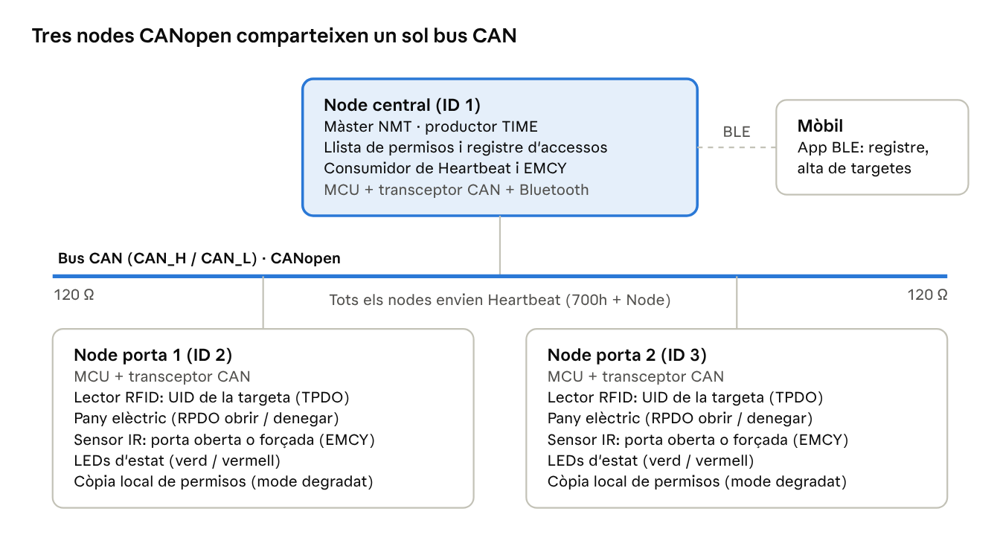

# Control d'accés RFID distribuït amb CANopen

**Sistemes Encastats i Ubics (SEU) · Treball dirigit 2026-27 · Proposta de disseny**

Grup: Abel Gallardo, Adrià Galdon, Albert Casamitjana

Proposem un sistema de control d'accés per a un edifici amb diverses portes. Cada porta és un node encastat amb lector RFID, i tots els nodes es comuniquen amb un node central per bus CAN amb protocol CANopen. Farem el treball **teòric**: proposta, memòria de disseny i defensa, sense prototip.

## 1. Objectius del disseny

1. **Controlar l'accés** a diverses portes amb targetes RFID, amb una única llista de permisos gestionada des d'un node central.
2. **Comunicar els nodes amb CANopen** sobre CAN bus, fent servir els serveis estàndard (NMT, Heartbeat, PDO, SDO, EMCY i TIME) en lloc d'un protocol propi.
3. **Detectar fallades**: saber en tot moment si un node porta o el node central ha deixat de respondre, i actuar en conseqüència.
4. **Mantenir el servei en mode degradat**: si cau el node central, cada porta continua funcionant amb una còpia local dels permisos.
5. **Respondre en temps acotat**: obrir la porta en menys de 500 ms des que es llegeix la targeta (requisit *soft real-time* que ens fixem nosaltres).
6. **Registrar els accessos** amb data i hora i poder consultar-los des d'un mòbil per Bluetooth.

## 2. Principals funcions

Cada funció es fa amb un servei CANopen concret:

| Funció | Què fa el sistema | Servei CANopen (COB-ID) |
| --- | --- | --- |
| Arrencada de la xarxa | El node central posa tots els nodes porta en estat *Operational* | NMT (000h) |
| Lectura de targeta | El node porta llegeix l'UID de la targeta i l'envia al central | TPDO de la porta (180h + Node) |
| Validació i obertura | El central consulta la llista de permisos i la franja horària i respon "obrir" o "denegar". La porta acciona el pany elèctric i activa el LED verd o vermell | RPDO de la porta (200h + Node) |
| Supervisió de nodes | Cada node envia un batec periòdic. Si en falta un, el central el marca com a caigut | Heartbeat (700h + Node) |
| Alarmes | El sensor IR detecta la porta oberta sense autorització (porta forçada) o oberta massa estona, i el node envia una alarma d'alta prioritat | EMCY (080h + Node) |
| Hora comuna | El central distribueix l'hora per registrar els accessos i aplicar les franges horàries | TIME (100h) |
| Configuració remota | Llegir i escriure paràmetres d'un node (temps d'obertura, mode) i actualitzar-ne la llista local de permisos | SDO (600h / 580h + Node) |
| Mode degradat | Si una porta deixa de rebre el Heartbeat del central, valida les targetes amb la seva còpia local i guarda els accessos fins que el central torna | Heartbeat (consumidor) |
| Gestió per Bluetooth | Des d'un mòbil es consulta el registre d'accessos i l'estat dels nodes, i es donen d'alta o de baixa targetes | BLE (fora de CAN) |

## 3. Esquema general de components

Tots els nodes s'hi connecten pel mateix bus CAN, amb una resistència de 120 Ω a cada extrem. El node central és l'únic que té Bluetooth. A la memòria justificarem el microcontrolador de cada node. Per exemple, el LPC1768 té controladors CAN integrats, i l'ESP32-C6 té CAN (TWAI) i Bluetooth integrats. En tots dos casos cal un transceptor CAN extern.

## 4. Decisió: treball teòric

Farem el treball **teòric**. Ens permet centrar-nos en l'arquitectura CANopen i en el comportament davant de fallades, sense dependre del material disponible al laboratori.

**Abast del disseny:** detallarem el sistema amb un node central i dues portes, i justificarem quantes portes admet el bus a partir del càlcul de la càrrega de missatges. Triarem components comercials per a cada node (pany elèctric, lector RFID, transceptor CAN i font d'alimentació), amb proveïdors, referències i preus.

**Validació sobre el paper:** en lloc d'una demo, la memòria descriurà aquests escenaris de prova i el comportament esperat del sistema:

1. Una targeta autoritzada obre la porta, i una de no autoritzada és denegada dins del temps màxim de resposta.
2. Algú obre una porta sense targeta: el node envia una alarma EMCY que arriba al central i al mòbil.
3. Cau el node central: les portes continuen funcionant amb la còpia local i guarden els accessos fins que el central torna.
4. Cau un node porta: el central detecta que falta el seu Heartbeat i ho notifica.

També inclourem el càlcul del temps de resposta, des de la lectura de la targeta fins a l'obertura, i una anàlisi de les fallades principals amb la resposta prevista per a cadascuna.
